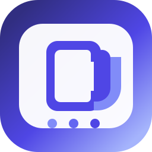

<p align="center">
  
</p>

<h1 align="center">ChordMaster</h1>

<p align="center">從排歌、練習到現場演出，讓敬拜團在同一份歌單裡協作。</p>

<p align="center">
  <a href="https://enoooch0921.github.io/chordmaster/">開啟 ChordMaster</a> ·
  <a href="docs/README.md">使用與開發文件</a> ·
  <a href="https://github.com/Enoooch0921/chordmaster/releases/latest">版本更新</a> ·
  <a href="https://github.com/Enoooch0921/chordmaster/issues">回報問題</a>
</p>

<p align="center">
  <a href="https://github.com/Enoooch0921/chordmaster/actions/workflows/deploy.yml"></a>
</p>

## 一份歌單，照顧不同的演出角色

ChordMaster 是支援手機、平板與電腦的歌曲庫、歌單及看譜工作區。可以先在本機使用，登入後同步個人資料，或與團隊共用曲庫與歌單。

| 工作 | 可以做什麼 |
| --- | --- |
| 找歌、排歌 | 搜尋歌名與歌詞、查看命中片段、收藏與最近使用、篩選 Key／BPM／拍號，拖曳安排歌序。 |
| 準備譜面 | 直接在預覽編輯和弦、節奏與簡譜；調整段落、曲序、Key、Capo 及演出註記。 |
| 看譜演出 | 全螢幕閱讀、切歌與翻頁；歌單保留各次演出的設定，個人顯示偏好不干擾其他團員。 |
| 歌詞閱讀 | 整份歌單固定字級，依畫面安排欄位；支援中英對照、原唱語言與獨立 A4 列印版面。 |
| 鼓手練習 | 精簡歌名、TAP 測速、節拍器及音色設定；快速停止、重開與切歌。 |
| 團隊協作 | 曲庫與歌單權限、來源版本比對、公開唯讀分享，以及 JSON 備份與 PDF 匯出。 |

### 從這裡開始

1. 在「歌曲」找到需要的歌曲，或匯入自己的歌譜。
2. 建立歌單、加入歌曲，設定這次演出的順序、調性與曲序。
3. 按角色選擇樂譜、歌詞或鼓手模式，準備好後進入演出模式。

歌單內的編輯會保留為該次演出的版本。將改動同步回曲庫是獨立操作，會先比對來源與差異；詳見[歌單來源版本](docs/setlist-source-versions.md)。

## 最新版本 · 0.12.29

- 修正全螢幕樂譜第一次換到下一首時，個人筆記工具觸發大範圍樣式重算所造成的停頓。
- 預備曲目時也讓 WebKit 提前繪製譜面，減少連續往後翻歌時的繪製工作。

[本版發佈說明](docs/release-0.12.29.md) · [完整更新紀錄](CHANGELOG.md)

## 本機開發

需求：**Node.js 22** 與 npm，與 GitHub Actions 使用的版本一致。

```bash
git clone https://github.com/Enoooch0921/chordmaster.git
cd chordmaster
npm ci
npm run dev
```

開啟 [localhost:3000](http://localhost:3000)。未設定後端時可使用本機工作區；資料存於瀏覽器 IndexedDB，建議定期匯出 JSON 備份。

若要開發登入、同步或分享功能，將 `.env.example` 複製為 `.env.local`，填入自己後端的公開用戶端設定。`VITE_` 變數會進入前端，勿填入管理金鑰。正式站使用教會 NAS 的 self-hosted Supabase；維護前請先閱讀 [AGENTS.md](AGENTS.md) 與[後端設定文件](docs/supabase-setup.md)。

| 指令 | 用途 |
| --- | --- |
| `npm run dev` | 啟動開發伺服器。 |
| `npm run lint` | TypeScript 型別檢查。 |
| `npm run test:run` | 執行完整 Vitest 測試。 |
| `npm run build` | 建置 GitHub Pages 網頁，輸出至 `dist/`。 |
| `npm run build:ipad` | 建置 Capacitor 使用的網頁資產。 |
| `npm run ipad:sync` | 建置並同步至 iOS 專案。 |
| `npm run ipad:open` | 在 Xcode 開啟 iPad 專案；執行需要完整 Xcode 與簽署設定。 |

## 文件與專案結構

[文件索引](docs/README.md)集中整理操作指南、資料同步與發佈紀錄。

```text
src/          React 介面、音樂資料模型、互動與測試
public/       圖示、離線 Service Worker 與音訊資源
ios/          Capacitor iPad 專案
supabase/     資料庫 migration 與 Edge Functions
docs/         操作指南、實作說明與版本紀錄
.github/      自動檢查與 GitHub Pages 發佈流程
```

主要使用 React 19、TypeScript、Vite、Tailwind CSS、Motion、Supabase 與 Capacitor。

推送至 `main` 後，GitHub Actions 依序執行型別檢查、測試與建置，再發佈至 GitHub Pages。網頁發佈不會自動變更 NAS 資料庫，也不會發佈原生 iPad App。

## 回報與使用範圍

遇到問題時，請在 [Issues](https://github.com/Enoooch0921/chordmaster/issues) 提供裝置、瀏覽器、版本及重現步驟；截圖請避開私人歌單與帳號資訊。

瀏覽器模擬測試不代表所有實體裝置皆已驗證，特別是 iPad／iPhone 的背景音訊與鎖屏操作。YouTube 參考播放器不直接改變音訊音高。

本儲存庫目前未設定開源授權；曲譜與歌詞的權利歸各自權利人所有。
